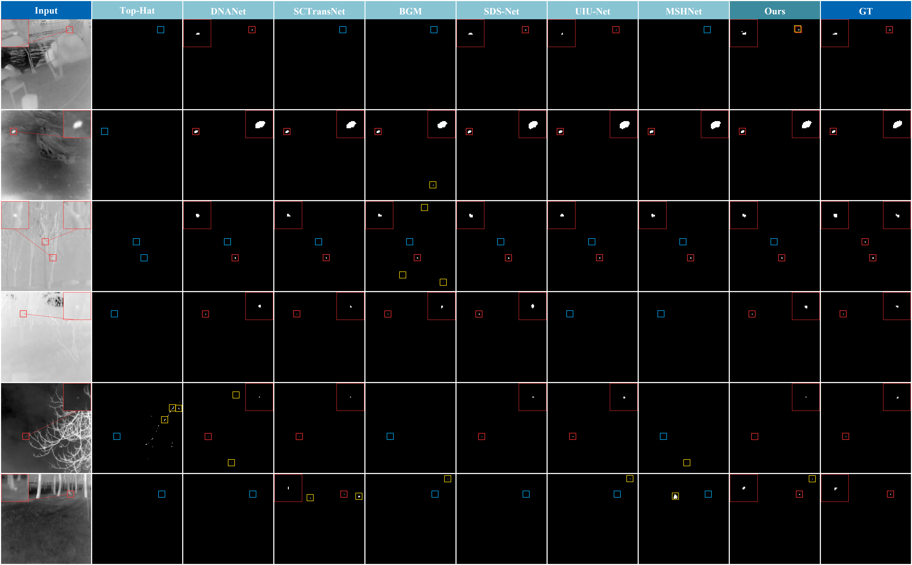

# Additional Qualitative Comparisons

*Visual comparison of correct detections, false alarms, and missed detections*

## Overview

This section presents additional qualitative comparisons of infrared small target detection methods on the test examples used for qualitative visualization in the MSHNet study.

The comparison examines target detection, false alarms, and missed detections across different infrared scenes.

## Qualitative Evaluation

The comparison uses the test examples presented in the qualitative visualization of MSHNet.

Detection outcomes are indicated using colored bounding boxes:

- **Red:** Correct detection.
- **Yellow:** False alarm.
- **Blue:** Missed detection.

These annotations provide a visual comparison of target localization and background interference responses among different detection methods.

## Results and Analysis

The additional comparison shows that BCSCENet maintains favorable target detection and false alarm suppression performance across the selected examples.

In the sixth-row example, BCSCENet and SCTransNet are the only two compared methods that correctly detect the target.

The results illustrate differences in target detection, false alarm suppression, and missed detection behavior among the evaluated methods in the selected infrared scenes.

---

[Back to the supplementary materials overview](../)
