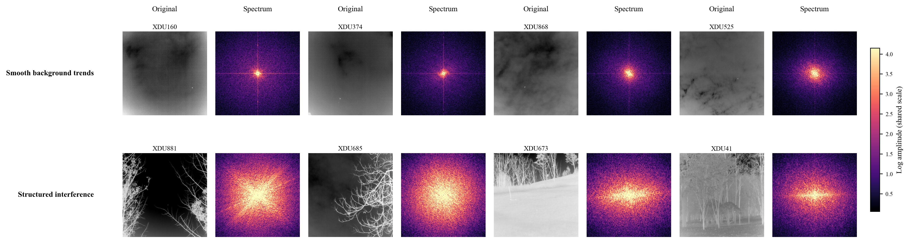

# Background Clutter Analysis

*Frequency-domain grouping and module response analysis on IRSTD-1K*

## Overview

This analysis investigates two background patterns in infrared small target detection: smooth background trends and structured interference.

Smooth background trends are characterized by slowly varying spatial responses over large continuous background regions, with spectral energy relatively concentrated at low frequencies.

Structured interference consists primarily of edge-like, line-like, or stripe-like background structures with richer spatial variations and relatively broader spectral distributions.

The analysis includes frequency-spectrum-based background grouping, distribution statistics, and the evaluation of DPBS and STAG on the corresponding background subsets.

## Background Classification Method

The classification is conducted on all 201 images in the IRSTD-1K test set using a consistent frequency-domain processing procedure.

Four representative Smooth images and four representative Structured images are used to construct reference spectra for the two background categories.

Each test image is classified according to its cosine similarity to the two reference spectra.

To evaluate classification stability, the reference images from both categories are resampled with replacement for 500 iterations. The reference spectra are reconstructed, and classification is repeated at each iteration.

A classification stability threshold of **τ = 0.80** is adopted. An image is assigned to a category when it receives the same classification in at least 400 of the 500 iterations. Otherwise, it is assigned to the Other category.

## Background Distribution

The resulting classification statistics are summarized below.

| Dataset   | Background Type | Images  | Percentage  |
| --------- | --------------- | ------- | ----------- |
| IRSTD-1K  | Smooth          | 122     | 60.70%      |
| IRSTD-1K  | Structured      | 47      | 23.38%      |
| IRSTD-1K  | Other           | 32      | 15.92%      |
| **Total** |              | **201** | **100.00%** |

The Smooth and Structured categories contain 169 images, representing 84.08% of the test set under the adopted classification procedure.

The complete per-image assignments are provided in [background_classification.csv](background_classification.csv).

## Representative Background Examples

Representative infrared images and their corresponding frequency spectra illustrate the spatial and spectral characteristics of the two background categories.

The examples show the relatively concentrated low-frequency responses associated with smooth background trends and the more extended spectral distributions associated with structured interference.

## Module Response Analysis

The contributions of DPBS and STAG are evaluated on the corresponding background subsets of IRSTD-1K.

| Background Subset | Model         | Images | mIoU (%) ↑ | Pd (%) ↑  | Fa (×10⁻⁶) ↓ |
| ----------------- | ------------- | ------ | ---------- | --------- | ------------ |
| Smooth            | w/o DPBS      | 122    | 70.15      | 90.66     | 13.26        |
| Smooth            | Full BCSCENet | 122    | **72.48**  | **93.41** | **2.75**     |
| Structured        | w/o STAG      | 47     | 63.57      | 90.48     | 23.38        |
| Structured        | Full BCSCENet | 47     | **71.72**  | **92.06** | **1.30**     |

## Analysis

On the Smooth subset, including DPBS increases mIoU by 2.33 percentage points and Pd by 2.75 percentage points, while reducing Fa by 10.51 × 10⁻⁶.

On the Structured subset, including STAG increases mIoU by 8.15 percentage points and Pd by 1.58 percentage points, while reducing Fa by 22.08 × 10⁻⁶.

These results indicate that DPBS and STAG contribute to improved detection performance under smooth background trends and structured interference, respectively.

---

[Back to the supplementary materials overview](../)
