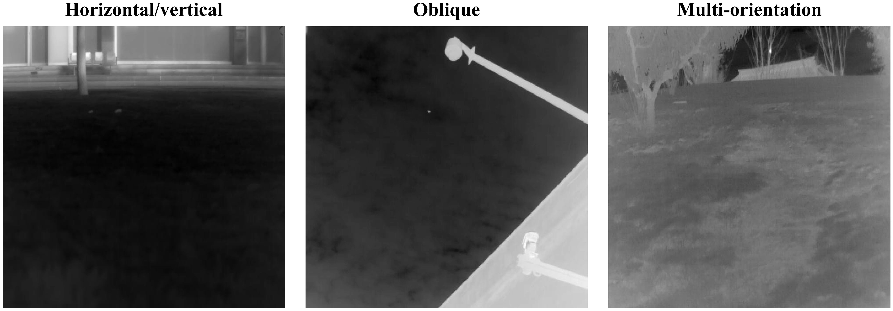

# STAG Orientation Analysis

*Evaluation under horizontal or vertical, oblique, and multi-orientation clutter*

## Overview

This experiment evaluates the performance of Structure Tensor Anisotropy Gate (STAG) under different structured-clutter orientations.

STAG incorporates local direction coherence and gradient magnitude differences to suppress structured background interference. The gradient magnitude difference term produces different responses across gradient orientations, motivating an evaluation of STAG under horizontal, vertical, oblique, and multi-orientation clutter.

## Orientation Subsets

The evaluation is conducted using the IRSTD-1K test set.

Three structured-clutter orientation subsets are constructed:

| Subset                      | Number of Images |
| --------------------------- | ---------------- |
| Horizontal/Vertical Clutter | 35               |
| Oblique Clutter             | 35               |
| Multi-orientation Clutter   | 35               |

The complete IRSTD-1K test set contains 201 images.

For orientation analysis, annotated targets and their surrounding neighborhoods are excluded from the background regions. Sobel operators are then applied to analyze the orientations of the remaining background structures, followed by manual verification of the image categories.

Each orientation subset contains 35 images with relatively clear corresponding directional characteristics. The three subsets do not cover the entire test set because some images do not contain sufficiently distinctive directional structures.

The complete image subsets are provided in [`horizontal_vertical`](subsets/horizontal_vertical/), [`multi_orientation`](subsets/multi_orientation/), and [`oblique`](subsets/oblique/).

Representative examples illustrate the three structured-clutter orientation categories.

## Quantitative Results

The complete model with STAG is compared against the corresponding variant without STAG.

| Structured-Clutter Subset   | Images | Method   | mIoU (%) ↑ | Pd (%) ↑  | Fa (×10⁻⁶) ↓ |
| --------------------------- | ------ | -------- | ---------- | --------- | ------------ |
| Overall Test                | 201    | w/o STAG | 67.42      | 92.52     | 14.88        |
| Overall Test                | 201    | w/ STAG  | **70.05**  | **93.54** | **7.74**     |
| Horizontal/Vertical Clutter | 35     | w/o STAG | 61.13      | 88.64     | 43.16        |
| Horizontal/Vertical Clutter | 35     | w/ STAG  | **66.20**  | **90.91** | **10.03**    |
| Oblique Clutter             | 35     | w/o STAG | 71.01      | **98.11** | 10.46        |
| Oblique Clutter             | 35     | w/ STAG  | **73.50**  | 96.23     | **0.87**     |
| Multi-orientation Clutter   | 35     | w/o STAG | 64.53      | 92.86     | 30.52        |
| Multi-orientation Clutter   | 35     | w/ STAG  | **66.85**  | **94.64** | **26.16**    |

## Analysis

Across the four evaluation groups, incorporating STAG improves 11 of the 12 reported metric comparisons.

On the overall test set and the horizontal/vertical and multi-orientation subsets, STAG improves mIoU and Pd while reducing Fa.

On the oblique subset, Pd decreases from 98.11% to 96.23%, corresponding to a reduction of 1.88 percentage points. Meanwhile, mIoU increases from 71.01% to 73.50%, and Fa decreases from 10.46 to 0.87 × 10⁻⁶.

These results indicate that STAG provides overall performance improvements across the evaluated structured-clutter orientations, although the oblique subset exhibits a trade-off between target detection probability and the other two metrics.

---

[Back to the supplementary materials overview](../)
